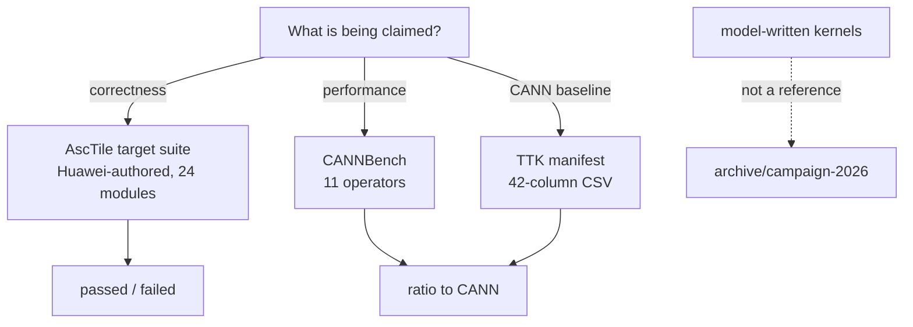

# Evidence sources

Three sources, one per kind of claim. If a statement about a kernel does not
trace back to one of them, it is not evidence.

| Claim | Source | Where | Verdict it yields |
|---|---|---|---|
| The kernel is correct | AscTile target suite | `reference/asctile/target/` | `passed` / `failed` per case |
| The kernel is fast | CANNBench | `integrations/cannbench/tasks/` | `ratio = ref_ticks / gen_ticks` |
| What "fast" is measured against | TTK manifest | CANN Test Tool Kit export | the CANN-side case definitions behind that ratio |



## The rule

**No model-written kernel is a reference.** Not for correctness, not for
tuning, not as a performance baseline. A kernel produced by a model is the
thing under test; comparing it to another kernel produced by a model measures
agreement, not accuracy. The `golden/` tree that once held 11 such kernels was
removed for exactly this reason and lives on `archive/campaign-2026`.

This cuts both ways. A model-written kernel that matches another model-written
kernel to the last bit has demonstrated nothing, and a model-written kernel
that beats one on ticks has not demonstrated speed.

One clarification, because the name invites the wrong conclusion: the suite
contains a `kimi_k3/` subpackage. That is upstream-authored content in
Huawei's own test tree, vendored verbatim like everything else under
`reference/asctile/target/`, and it is a reference. The rule above is about
kernels *this* repository's agents produce, not about how upstream chose to
name a directory. Judge provenance by who wrote and ships the code, not by
what it is called.

## Correctness — the AscTile target suite

Huawei-authored, vendored from upstream `pyasc` and pinned. 24 test modules.
Each case asserts numerical output against a reference the suite computes
itself — *when the suite is run normally*. Our `merge-gate` does not run it
normally; see "What the compile gate does and does not establish" below.

Case counts move with the pin, so this document does not carry one. Derive it
from the tree you actually have:

```bash
pytest reference/asctile/target --collect-only -q | tail -1
```

At `source_sha` `d0f64a63` that reported 1155 (2026-10-26). Treat any number
written down elsewhere as the count for *some* revision and re-derive it
rather than repeating it.

The suite needs a working AscTile runtime; `reference/asctile/conftest.py`
resolves one and fails with a readable diagnostic if neither
`asc.experimental.asctile` (published wheel) nor a top-level `asctile`
(legacy source build) is usable.

- Layout, pin and local modifications: [`../reference/README.md`](../reference/README.md)
- Re-vendoring: `scripts/sync-target-suite.sh`
- Drift check (offline, runs in `--fast`): `scripts/check-target-pin.sh`

Run it:

```bash
pytest reference/asctile/target/test_vadd.py --backend Model --platform Ascend950PR_9599
```

`Backend.Model` is the camodel simulator, not hardware. A pass there is a
simulator pass, and reports should say so — see
[`../skills/pyasc-build-run-verify/references/hardware.md`](../skills/pyasc-build-run-verify/references/hardware.md).

### What the runtime underneath is qualified for

The suite runs inside the simulator image pinned by
[`../reference/images/ENV.json`](../reference/images/ENV.json), built and
published by `compiler-team-ru/pyasc-images`. That image carries its own
verification scope, and it is a narrow one. Quoting `matrix.json` verbatim:

> Upstream vector-add compile and simulator smoke, 128 float32 elements. No
> hardware or broad numerical qualification.

So the image is evidence that the toolchain installs and runs, nothing more.
Every correctness claim above rests on the target suite, not on the image
having been "tested". The two are separate gates and should stay that way in
any report.

The minimal image ships neither `torch` nor `pytest`, both of which the suite
needs. CI therefore runs the *development overlay* instead.

### The dev overlay line, and what "published" means there

`ghcr.io/compiler-team-ru/pyasc-sim-dev` is the same simulator image with CPU
Torch, pytest and their dependencies baked in. It is what CI runs, pinned by
`.dev_image.ref` in [`../reference/images/ENV.json`](../reference/images/ENV.json)
alongside the exact `torch` and `pytest` versions it contains, which
`tests/tools/verify_pyasc_image.sh` asserts. Taking the versions from upstream
rather than from whatever `pip install torch` resolved that morning is the
point: our results are then comparable with upstream's.

The overlay is published per base. `scripts/check-image-pin.sh` asserts that
`.dev_image.base_report` equals `.matrix.release_tag`, so the suite, the wheel
and the runtime always derive from one upstream commit. The overlay line
follows new bases on a delay, so `scripts/sync-image-pin.sh` refuses to pin a
base that has no overlay yet rather than pinning something CI cannot run.

The thing to be careful about is what these images are certified for. Upstream
is explicit, and the wording is worth keeping intact:

> `published` means **environment-qualified**, not that the full suite passed.

Publication requires dependency consistency, preserved base packages, native
imports, CPU Torch operations, collection of every AscTile test, and the
baseline compile/simulator check. **Execution of the suite is not among them.**

In this repository's vocabulary a published overlay is `not-run`, not `passed`.
It is evidence that the environment is coherent — the right packages,
importable, able to collect every test and compile the baseline. It is not
evidence that any kernel produced a correct number. Citing it as if it were
would be the same error as citing a model-written kernel as a reference: a real
artefact, read as answering a question it was not asked.

### Reading the qualification report

Full-suite execution runs separately and lands in the
`qualification_report` URL recorded in `ENV.json`. Its filename carries a hash
of upstream's qualification code, so a report is tied to the logic that
produced it; the pinned URL is the immutable per-release one.

Upstream defines five states. The mapping into our vocabulary:

| Upstream | Ours | Why |
|---|---|---|
| `pending` | `not-run` | Qualification has not reached this cell. Not a pass, not a failure. |
| `complete` + `suite_status: passed` | `passed` | Read the skip and xfail counts too; a pass with everything skipped is not a pass. |
| `complete` + `suite_status: failures` | `failed` | Real failures. |
| `incomplete` or `blocked` | `blocked` | Interrupted. See below. |
| `incompatible` | excluded | The cell cannot be built. **Never** a pass. |

#### The current snapshot, and why you should re-derive it

This moves. It was `pending` on 2026-10-26 and `incomplete` two days later, so
treat any state written here as stale and read the report yourself:

```bash
curl -fsSL "$(jq -r .dev_image.qualification_report reference/images/ENV.json)" \
  | jq '.cells[] | select(.key=="u22.04-c9.2.0-p3.11-arm64")
        | {status, suite: {collected: .suite.collected, executed: .suite.executed,
                           counts: .suite.counts, suite_status: .suite.suite_status}}'
```

As of 2026-10-28, for the pinned `u22.04-c9.2.0-p3.11` cell on both
architectures: `status: incomplete` — so, **`blocked`**, not `not-run`.
4293 collected, 2903 executed, 2824 passed, 79 skipped, **zero failures**.

That last number is tempting and must not be over-read. Of the 70 modules,
31 are `complete`, 38 are `not-run` and 1 is `blocked` — and **all 24 modules
under `target/`, the subtree this repository vendors and gates on, are
`not-run`.** The passes come from `unit/` and `operations/`. So there is now
real numerical evidence upstream, and none of it covers our gate.

The interrupted case is the one that invites a wrong inference, and upstream's
caution is worth quoting rather than paraphrasing:

> OOM, timeout, or a killed runner may leave no evidence for the interrupted
> module. A cell is then incomplete/blocked, not a failed kernel. The report
> does not yet supply a reliable four-state per-case inventory for that
> situation, **nor does exit 137 prove OOM**. Consumers must keep unresolved
> modules `blocked`/unknown until logs and host evidence diagnose them; they
> must not infer `failed` or `not-run` from absence alone.

One part of that has since been overtaken: the report now *does* carry a
four-state per-module inventory (`complete | not-run | blocked | incompatible`)
under `suite.modules`, which is what the paragraph above is counted from. The
caution still holds, because per-*module* is not per-*case*, and a `blocked`
module still carries no diagnosis of why.

Upstream's runner limits are two CPUs and 12 GiB per container, up to three
hours per module and six hours per matrix job — useful when judging whether a
module plausibly ran out of room, but a plausible cause is not a diagnosis.

A note on scope, since the subtree names suggest more than they deliver:
`unit/` exercises the frontend and IR with the compiler and launcher mocked;
`operations/` is the operation-level JIT path with reference checks, and is the
real simulator numerical gate; `target/` and `kernels/` are larger kernels that
require C310 hardware and are resource-heavy. `target/`, which is what this
repository vendors, is a reasonable focused downstream gate — not the entire
upstream correctness reference.

The dev images do not bundle upstream source. They expect a checkout to be
mounted, which is the shape CI already uses.

### What the compile gate does and does not establish

`merge-gate` runs the target suite through `tests/tools/run_target_test.py`,
which defaults to `--compile-only`. That mode mocks kernel launch and the
numerical assertions. It establishes that every kernel in the suite builds
against the pinned runtime — a genuine and useful signal, and the one that
catches API drift first. It establishes **nothing** about numerical
correctness, and must never be reported as if it did. Upstream's own
formulation: do not describe `--compile-only` as numerical qualification.

Numerical execution on the camodel remains deferred; it is not scheduled to a release.

## Performance — CANNBench

`integrations/cannbench/tasks/` holds 11 operators: `exp`,
`foreach_addcdiv_scalar`, `foreach_norm`, `gelu`, `masked_scale`, `mish`,
`rms_norm`, `sigmoid`, `softmax`, `swi_glu`, `transpose`. Each carries
upstream-licensed `proto.yaml`, `cases.yaml`, `cases.csv`, `golden.py` and
`desc.md`.

The metric is `ratio = ref_ticks / gen_ticks`, where `ref_ticks` comes from the
canonical AscendC implementation of the same operator and `gen_ticks` from the
generated kernel, both measured on the same camodel. `>= 0.70` means within
roughly 30% of hand-written. The symmetry requirements — identical shapes,
dtypes, platform and fixed-overhead treatment on both sides — are what make the
number mean anything, and they are spelled out in
[`perf-methodology/ticks-calculation.md`](perf-methodology/ticks-calculation.md).

## The CANN baseline — TTK

TTK, the CANN Test Tool Kit, is what CANN's own measurement is driven from, so
it is what "fraction of CANN" is a fraction *of*. Its 42-column manifest
defines each case precisely enough to be reproduced on the CANN side: shapes,
formats, dtypes, tolerances, data ranges, tiling key.

See [`../skills/pyasc-cannbench-kernel/references/ttk.md`](../skills/pyasc-cannbench-kernel/references/ttk.md).

## Status

| Source | State |
|---|---|
| Target suite | Vendored and pinned; 24 modules. **Compile-checked only** in `merge-gate` — launch and numerical assertions are mocked. Full numerical execution on the camodel remains deferred. |
| Upstream qualification | Published per overlay release. `incomplete` for the pinned cell as of 2026-10-28, i.e. `blocked` — 2824 passed, 0 failed, but every `target/` module still `not-run`. Re-derive before citing. |
| CANNBench | Task definitions tracked. The campaign-era runner and its results were archived; a scorer that produces ratios from a clean clone is still unbuilt. |
| TTK | Column shape and role documented. The generator read an absolute path outside the repository, so the manifest is **not reproducible here yet**, and making it portable is still open. |

Honest `blocked` beats an invented number. The gate vocabulary is
`passed | failed | blocked | not-run`, and generation, compile, numerical and
hardware are separate gates — see
[`../skills/pyasc-codegen-workflow/references/workflow.md`](../skills/pyasc-codegen-workflow/references/workflow.md).
