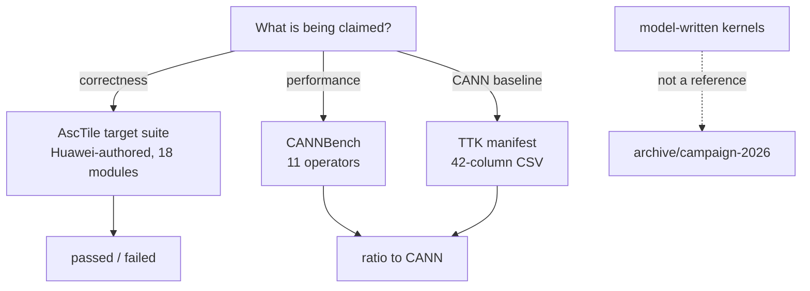

# Evidence sources

Three sources, one per kind of claim. If a statement about a kernel does not
trace back to one of them, it is not evidence.

| Claim | Source | Where | Verdict it yields |
|---|---|---|---|
| The kernel is correct | AscTile target suite | `reference/asctile/target/` | `passed` / `failed` per case |
| The kernel is fast | CANNBench | `integrations/cannbench/tasks/` | `ratio = ref_ticks / gen_ticks` |
| What "fast" is measured against | TTK manifest | CANN Test Tool Kit export | the CANN-side case definitions behind that ratio |



## The rule

**No model-written kernel is a reference.** Not for correctness, not for
tuning, not as a performance baseline. A kernel produced by a model is the
thing under test; comparing it to another kernel produced by a model measures
agreement, not accuracy. The `golden/` tree that once held 11 such kernels was
removed for exactly this reason and lives on `archive/campaign-2026`.

This cuts both ways. A model-written kernel that matches another model-written
kernel to the last bit has demonstrated nothing, and a model-written kernel
that beats one on ticks has not demonstrated speed.

## Correctness — the AscTile target suite

Huawei-authored, vendored from upstream `pyasc` and pinned. 18 test modules,
891 parametrised cases, each asserting numerical output against a reference
the suite computes itself.

The suite needs a working AscTile runtime; `reference/asctile/conftest.py`
resolves one and fails with a readable diagnostic if neither
`asc.experimental.asctile` (published wheel) nor a top-level `asctile`
(legacy source build) is usable.

- Layout, pin and local modifications: [`../reference/README.md`](../reference/README.md)
- Re-vendoring: `scripts/sync-target-suite.sh`
- Drift check (offline, runs in `--fast`): `scripts/check-target-pin.sh`

Run it:

```bash
pytest reference/asctile/target/test_add.py --backend Model --platform Ascend950PR_9599
```

`Backend.Model` is the camodel simulator, not hardware. A pass there is a
simulator pass, and reports should say so — see
[`../skills/pyasc-build-run-verify/references/hardware.md`](../skills/pyasc-build-run-verify/references/hardware.md).

## Performance — CANNBench

`integrations/cannbench/tasks/` holds 11 operators: `exp`,
`foreach_addcdiv_scalar`, `foreach_norm`, `gelu`, `masked_scale`, `mish`,
`rms_norm`, `sigmoid`, `softmax`, `swi_glu`, `transpose`. Each carries
upstream-licensed `proto.yaml`, `cases.yaml`, `cases.csv`, `golden.py` and
`desc.md`.

The metric is `ratio = ref_ticks / gen_ticks`, where `ref_ticks` comes from the
canonical AscendC implementation of the same operator and `gen_ticks` from the
generated kernel, both measured on the same camodel. `>= 0.70` means within
roughly 30% of hand-written. The symmetry requirements — identical shapes,
dtypes, platform and fixed-overhead treatment on both sides — are what make the
number mean anything, and they are spelled out in
[`perf-methodology/ticks-calculation.md`](perf-methodology/ticks-calculation.md).

## The CANN baseline — TTK

TTK, the CANN Test Tool Kit, is what CANN's own measurement is driven from, so
it is what "fraction of CANN" is a fraction *of*. Its 42-column manifest
defines each case precisely enough to be reproduced on the CANN side: shapes,
formats, dtypes, tolerances, data ranges, tiling key.

See [`../skills/pyasc-cannbench-kernel/references/ttk.md`](../skills/pyasc-cannbench-kernel/references/ttk.md).

## Status

| Source | State |
|---|---|
| Target suite | Vendored and pinned; collects 891 cases. Compile-checked in `merge-gate`. Full numerical execution on the camodel is a v0.2.0 gate. |
| CANNBench | Task definitions tracked. The campaign-era runner and its results were archived; a scorer that produces ratios from a clean clone is v0.2.0. |
| TTK | Column shape and role documented. The generator read an absolute path outside the repository, so the manifest is **not reproducible here yet** — v0.2.0. |

Honest `blocked` beats an invented number. The gate vocabulary is
`passed | failed | blocked | not-run`, and generation, compile, numerical and
hardware are separate gates — see
[`../skills/pyasc-codegen-workflow/references/workflow.md`](../skills/pyasc-codegen-workflow/references/workflow.md).
